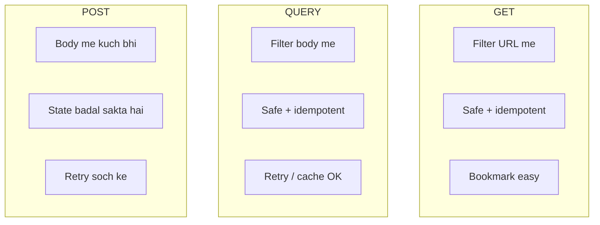

# HTTP QUERY — padhne layak notes

> **QUERY** = “is collection par yeh filter chalao, result do, **kuch mat badlo**.”  
> Body me query. Method **safe** aur **idempotent**. Cache + retry allowed.

Spec: [RFC 10008](https://www.rfc-editor.org/rfc/rfc10008.html) (June 2026, IETF Standard)  
MDN: [QUERY request method](https://developer.mozilla.org/en-US/docs/Web/HTTP/Reference/Methods/QUERY)

---

## Index

1. [Problem — GET aur POST kyun kaafi nahi](#1-problem--get-aur-post-kyun-kaafi-nahi)
2. [QUERY kya hai](#2-query-kya-hai)
3. [GET vs QUERY vs POST](#3-get-vs-query-vs-post)
4. [Request kaise dikhti hai](#4-request-kaise-dikhti-hai)
5. [Headers — Allow, Accept-Query, Content-Type](#5-headers--allow-accept-query-content-type)
6. [Status codes](#6-status-codes)
7. [Location vs Content-Location](#7-location-vs-content-location)
8. [Caching, retry, CORS](#8-caching-retry-cors)
9. [Security](#9-security)
10. [Kab GET, kab QUERY, kab POST](#10-kab-get-kab-query-kab-post)
11. [Is folder ka demo](#11-is-folder-ka-demo)

---

## 1. Problem — GET aur POST kyun kaafi nahi

Pehle complex search aise hota tha:

```http
GET /users?gender=male&minSalary=12000&name=alok HTTP/1.1
```

**GET + query string** tab theek hai jab filter chhota ho. Problem:

- URL length limit (kai systems ~8000 chars; SQL / JSONPath usse bada ho sakta hai)
- Encoding messy (`%20`, nested JSON)
- URL **logs, bookmarks, browser history** me chali jaati hai — password / aadhar filter ke liye kharab
- Har combo alag “resource” jaisa treat hota hai

Isliye log **POST** se search karte the:

```http
POST /users/search HTTP/1.1
Content-Type: application/json

{"gender":"male","minSalary":12000}
```

POST me body aati hai — theek. Lekin POST **safe nahi** maana jaata: retry se doosri baar **insert / payment** ho sakta hai. Cache / automatic retry risky.

**QUERY** yeh gap bharta hai: body `POST` jaisi, rules `GET` jaise.

```http
QUERY /users HTTP/1.1
Content-Type: application/json

{"gender":"male","minSalary":12000}
```

---

## 2. QUERY kya hai

Target resource se kaho: **is body ko query samajh ke chalao**, result response me do.

- Body + `Content-Type` = query kya hai  
- URL = **kis collection** par (jaise `/users`, `/contacts`)  
- Server data **change nahi** karta (safe)  
- Same request dobara = same *intent*, koi extra write nahi (idempotent)  
- Response **cacheable** (cache key me body bhi shamil)

SQL socho: `SELECT` = QUERY. `INSERT/UPDATE/DELETE` = POST/PUT/PATCH/DELETE.

| Property | QUERY |
|----------|--------|
| Request body | Haan (expected) |
| Response body | Haan (result) |
| Safe | Haan |
| Idempotent | Haan |
| Cacheable | Haan |
| HTML form se | Nahi |

`GET` resource **ka representation** maangta hai.  
`QUERY` resource se **operation (query)** maangta hai, uske scope me.

---

## 3. GET vs QUERY vs POST



RFC table (short):

| | GET | QUERY | POST |
|--|-----|--------|------|
| Safe | yes | yes | maybe no |
| Idempotent | yes | yes | maybe no |
| Body semantics | defined nahi | query content | resource decide kare |
| Cache | yes (URI key) | yes (**URI + body** key) | limited |
| Same query ko URI do | URL khud hai | optional `Location` | nahi |

---

## 4. Request kaise dikhti hai

```http
QUERY /users HTTP/1.1
Host: localhost:3008
Content-Type: application/json
Accept: application/json

{
  "gender": "male",
  "minSalary": 12000,
  "limit": 10
}
```

Success:

```http
HTTP/1.1 200 OK
Content-Type: application/json
Accept-Query: application/json
Allow: GET, QUERY, POST, OPTIONS, HEAD

[
  { "uid": 1, "name": "alok", "gender": "male", "salary": 13000 }
]
```

`fetch` (browser / Node):

```javascript
const res = await fetch("http://localhost:3008/users", {
  method: "QUERY",
  headers: { "Content-Type": "application/json", Accept: "application/json" },
  body: JSON.stringify({ gender: "male", minSalary: 12000 }),
});
const rows = await res.json();
```

`QUERY` CORS safelist me nahi — cross-origin pe pehle `OPTIONS` preflight.

---

## 5. Headers — Allow, Accept-Query, Content-Type

**Support pata karna**

```http
OPTIONS /users HTTP/1.1
Host: localhost:3008
```

```http
HTTP/1.1 204 No Content
Allow: GET, QUERY, POST, OPTIONS, HEAD
Accept-Query: application/json
```

- `Allow` — kaunse methods  
- `Accept-Query` — query body ka **kaunsa media type** chalega (`application/json`, `application/sql`, form…)  

**`Content-Type` zaroori hai.** Server guess nahi karega (no sniffing). Missing / galat type = error.

---

## 6. Status codes

| Code | Kab |
|------|-----|
| `200 OK` | Query chali, result body me |
| `204` | OPTIONS / koi content nahi |
| `400 Bad Request` | `Content-Type` missing, ya body type se match nahi |
| `405 Method Not Allowed` | QUERY support nahi; `Allow` dekho |
| `406 Not Acceptable` | `Accept` wala format server nahi de sakta |
| `415 Unsupported Media Type` | Type pata hai lekin is resource pe query nahi (ya unknown) |
| `422 Unprocessable Content` | JSON theek, lekin query logic galat (jaise `minSalary` string) |

---

## 7. Location vs Content-Location

RFC kehta hai: QUERY ka **equivalent resource** conceptually hamesha hai. Server usko URI de **sakta** hai.

| Header | Matlab | Baad me `GET` |
|--------|--------|----------------|
| `Content-Location` | **Is baar** ka stored result | Wahi purana snapshot |
| `Location` | Same query **dobara chalao** (bina body) | Latest data — result badal sakta hai |

```http
HTTP/1.1 200 OK
Content-Location: /users/results/17
Location: /users/queries/42
```

Sensitive query ko in URLs me **mat chipkao** — warna GET wala leak wapas aa gaya.

Redirect: `301/302/307/308` ke baad bhi client **QUERY + same body** bheje. POST wala “redirect pe GET bana do” yahan apply nahi.  
`303 See Other` = ab `GET Location` kaafi hai.

---

## 8. Caching, retry, CORS

- **Retry:** connection tootega to QUERY dobara bhejo — extra insert nahi.  
- **Cache:** key = method + URI + **poori body** + Content-Type. `GET` se mushkil.  
- `Vary: Content-Type` (aur kabhi `Accept`)  
- Conditional: `If-None-Match` → `304` agar result same  
- CORS: `Access-Control-Allow-Methods: GET, QUERY, OPTIONS`

HTML form `QUERY` nahi bhejta. Developer `fetch` / backend client use kare.

---

## 9. Security

Body URI se **kam log** hoti hai — confidential filters ke liye QUERY better than `GET ?aadhar=`.

Phir bhi:

- HTTPS  
- Auth (`Authorization`)  
- Equivalent URI me secrets nahi  
- SQL-in-body ho to **parameterize** — raw SQL string mat chalao  

---

## 10. Kab GET, kab QUERY, kab POST

| Situation | Method |
|-----------|--------|
| Chhota filter, bookmark chahiye | `GET /users?country=1` |
| Badi / JSON / SQL jaisi query, retry safe | **`QUERY /users`** |
| Naya user, payment, delete | `POST` / `PUT` / `DELETE` |
| “search” naam ka POST jo sirf padhta ho | naya design me QUERY |

QUERY **GET ki jagah har jagah nahi**. Chhoti public search ke liye GET ab bhi sahi.

---

## 11. Is folder ka demo

`node server/index.js` — port **3008**.

| Method | Path | Effect |
|--------|------|--------|
| `GET` | `/users` | saari rows |
| `QUERY` | `/users` | JSON filter, **write nahi** |
| `POST` | `/users` | naya user **add** |
| `OPTIONS` | `/users` | `Allow` + `Accept-Query` |
| `GET` | `/users/results/:id` | last QUERY ka snapshot |
| `GET` | `/users/queries/:id` | wahi filter latest data par |

Filter fields: `name`, `gender`, `country`, `minSalary`, `maxSalary`, `limit`.

Poora flow: [client/query.mjs](client/query.mjs) · curl: [client/curl.md](client/curl.md)
